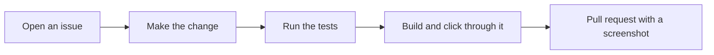
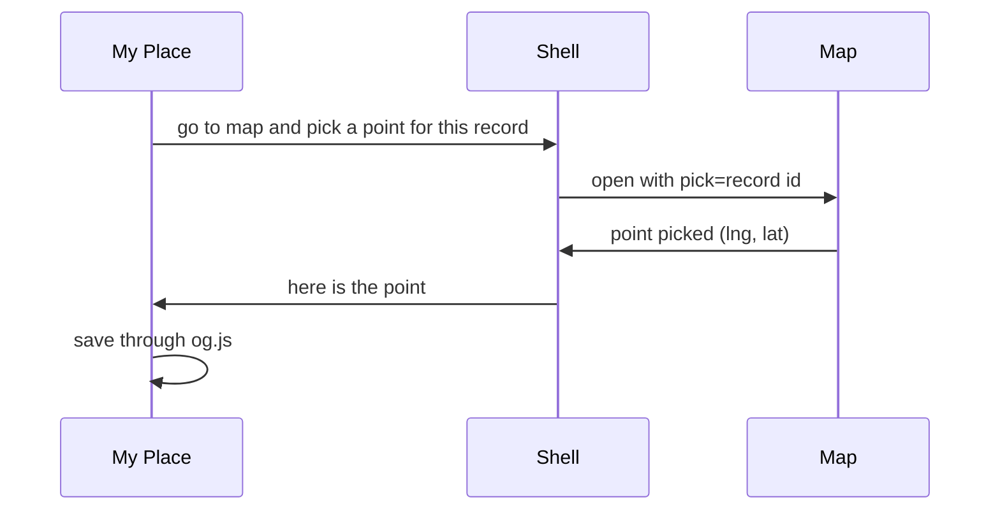
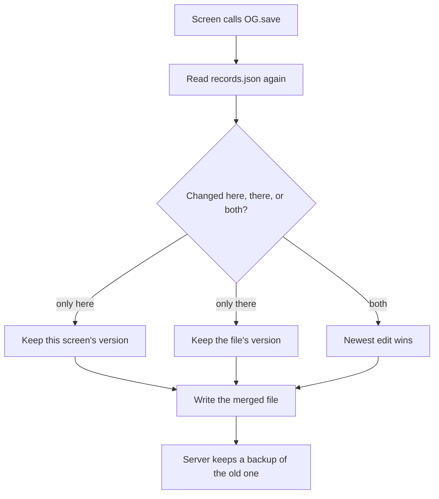

# Contributing

Thanks for wanting to help. This is a small project I built for my own house, so the rules are short.

## The quickest way to help

- **Found a bug?** Open an issue. Say what you did, what you expected and what happened. A screenshot helps a lot.
- **Something confusing?** That counts as a bug. If you couldn't figure out a screen, tell me which one.
- **Got a fix?** Open a pull request. Small ones get looked at fastest.

## Getting set up

You need a Mac with Apple's command line tools (`xcode-select --install`).

```
git clone https://github.com/builtby-hari/Off-Grid-Fieldbook.git
cd Off-Grid-Fieldbook
./app/build-app.sh share
```

To work on the screens without rebuilding every time, run the built app's server on its own and open it in a browser:

```
OFFGRID_CONTENT="$PWD/Apps/Off-Grid Fieldbook (share).app/Contents/Resources/Content" \
OFFGRID_DATA=/tmp/fieldbook-test-data \
"Apps/Off-Grid Fieldbook (share).app/Contents/MacOS/OffGrid" --serve-only
```

It prints an address. `OFFGRID_DATA` points it at a scratch folder so you never touch real records while testing.

Run the tests before you send anything:

```
node tests/og-store.test.js
node tests/routes.test.js
node tests/water-units.test.js
node tests/syntax.test.js
```

## How a change flows



## The rules that matter

1. **It has to work offline.** No CDNs, no web fonts, no network calls while the app is in use. If your change needs the internet at runtime, it doesn't fit.
2. **Never lose someone's records.** All reading and saving goes through `app/web/og.js`. If you change the shape of a record, write a migration and bump the schema version.
3. **Don't invent safety advice.** The emergency steps and numbers come from Ready.gov, the CDC, the EPA and the USDA. If you change one, link the official source in your pull request.
4. **One design system.** Colors, type and components live in `app/web/ui.css`. Screens don't define their own colors.
5. **Screens don't reach into each other.** They ask the shell to go somewhere. `app/web/CONTRACT.md` has the whole contract, and it's short.
6. **Plain English in the app.** Short sentences, no jargon. Status is always a word, never a color alone. Every button and input works from the keyboard.
7. **Respect licenses.** Don't add documents, map data or code you don't have the right to share. Public domain and Creative Commons are fine. If you're not sure, ask in an issue first.
8. **No personal data.** No addresses, coordinates of someone's home, phone numbers or keys in code, tests or screenshots.

## How the screens talk

Each screen is its own page. None of them touch each other. They ask the shell.



Saving is the part to be careful with. Two screens can hold the records at once, so a save always reads the file again and merges first:



## Where things are

| Folder | What's in it |
|---|---|
| `app/macos/` | The Mac app shell (Swift), one file per job: `Server`, `Records`, `Packs`, `Setup`, `Files`, `Kiwix`, `Window`, `main` |
| `app/web/` | The screens: Home, My Place, Learn, Plants, guides, Get maps, Offline check, the shell and shared code |
| `app/web/data/` | The emergency scenarios |
| `app/web/map/` | The map screen and its libraries |
| `tools/packs/` | The map pack downloader |
| `tools/library/` | The PDF text reader and the search index builder |
| `tests/` | Tests |
| `content/library/` | The library catalog and the manuals that ship with the repo |

## Good first things to pick up

- Try the app with a state other than Texas and report what breaks.
- Light mode and print layouts need more eyes.
- The plant zone filter is fixed at USDA zone 8. It should be a setting.
- The Get maps screen shows the raw download log. A real progress bar would be nicer.
- The map downloader needs Python. Rewriting it in Swift would remove that.
- A Windows shell. The screens are plain web pages, so they should carry over.

## Pull requests

- Keep each one to a single change.
- Say what you tested and how.
- Screenshots for anything you can see.

By sending a pull request you agree your change is released under the MIT License, the same as the rest of the code.
