<p align="center"></p>

# Off-Grid Fieldbook

An offline survival app for the Mac. Maps, manuals, your own gear and supplies, and what to do when something goes wrong. It all runs on your computer and keeps working with no internet, no cell service and no account.

I built it for my own house after thinking about what I'd actually need in a long outage. The idea is simple: when the internet is down, the answer should already be on the laptop.

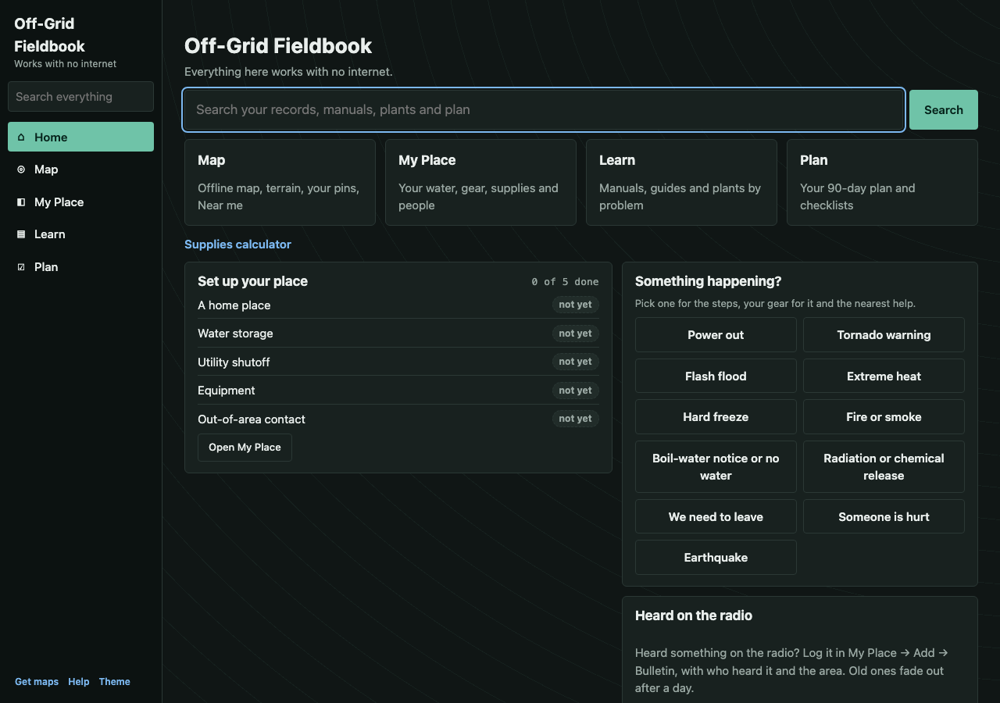

## Where this is at

Read this part first so you know what you're getting.

| Thing | State |
|---|---|
| The app on a Mac | Works. I use it |
| Home, My Place, Learn, search | Works |
| Offline map with terrain and survival layers | Works once you download a map pack |
| Getting a map for your state | Works from inside the app: press Get maps, pick a state, download |
| A ready-made download you just double-click | Not yet. For now you build it from this repo |
| Windows | Planned. The app shell is Mac-only today |
| iPhone | Planned |
| Offline routing around a closed road | Planned |

This repo is the code. It does not contain map data, library files or anyone's personal records. You download the data yourself, and the steps are below.

## What's inside

Five pages and one search box.

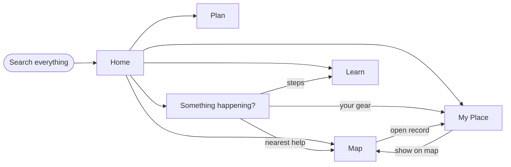

**Home.** Where everything is and how ready you are. A checklist to set up your place, how long your supplies will last, and a "Something happening?" box with steps for a power outage, tornado, flood, extreme heat, hard freeze, fire or smoke, no water, radiation, evacuation, an injury and an earthquake. The steps come from Ready.gov, the CDC, the EPA and the USDA.

Pick what's happening and you get the steps, your own gear for it, and the nearest help in one place:

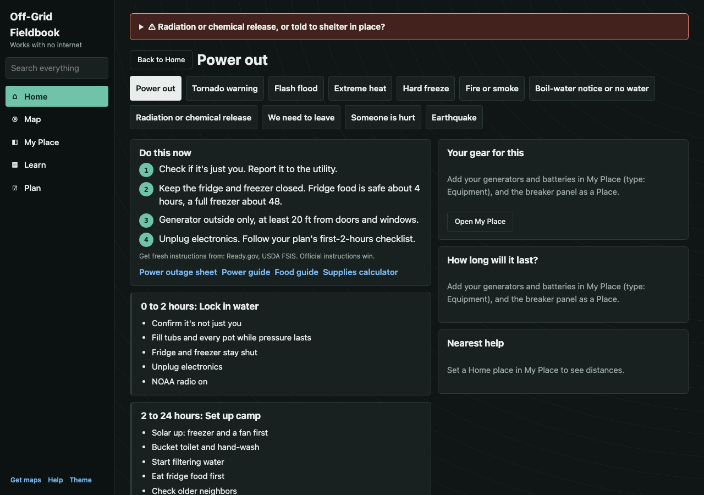

**Map.** An offline map with street detail, hill shading and elevation lines. Layers for springs, wells, hospitals, pharmacies, fire stations, shelters, fuel, railroads and more. Drop pins, measure distance, and see what's nearest to you with distance and direction.

**My Place.** Records for your water storage, water sources, equipment, supplies, shelters, places, routes, contacts and things you heard on the radio. Each one has a status, photos, notes and a spot on the map. It also has a supplies calculator (people, pets, days, heat) and readiness drills.

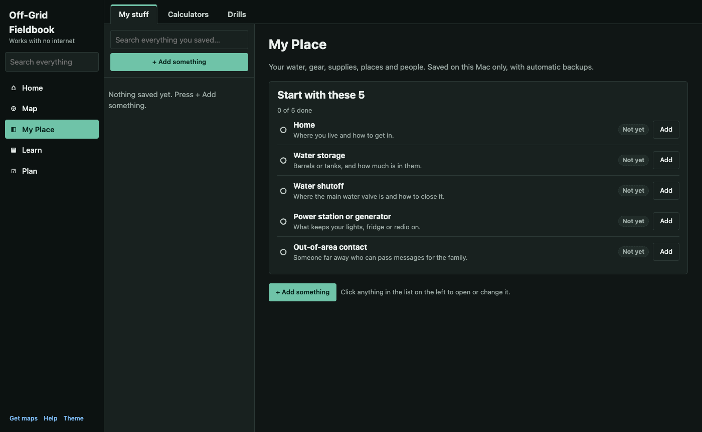

Adding something takes two steps: pick what it is, name it. Things that sit at a spot (home, a water shutoff, a barrel) go straight to the map so you can click where they are.

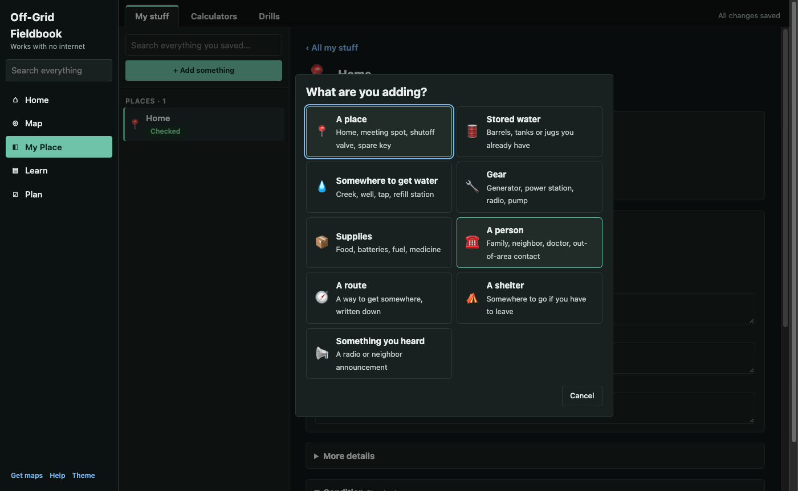

Each thing you save opens with the pin and a few basics. The rest is folded away until you want it.

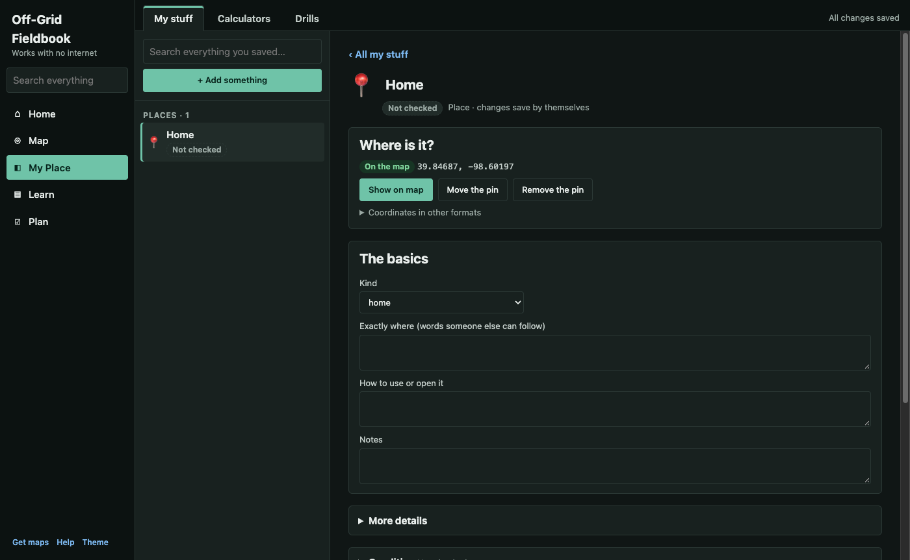

The supplies calculator works out water, food and gear for your household and compares it to what you have:

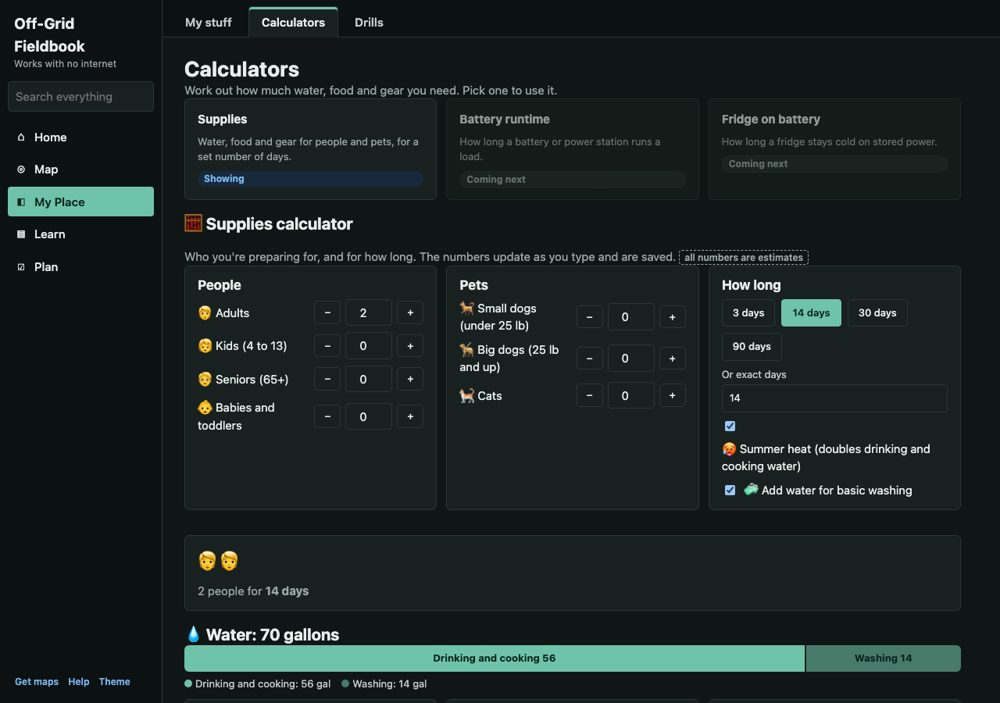

**Learn.** A library sorted by problem: Water, Food, Power and tools, Health, Hazards, Plants, How-to. Each one has short guides first, then full manuals, then the big reference collections.

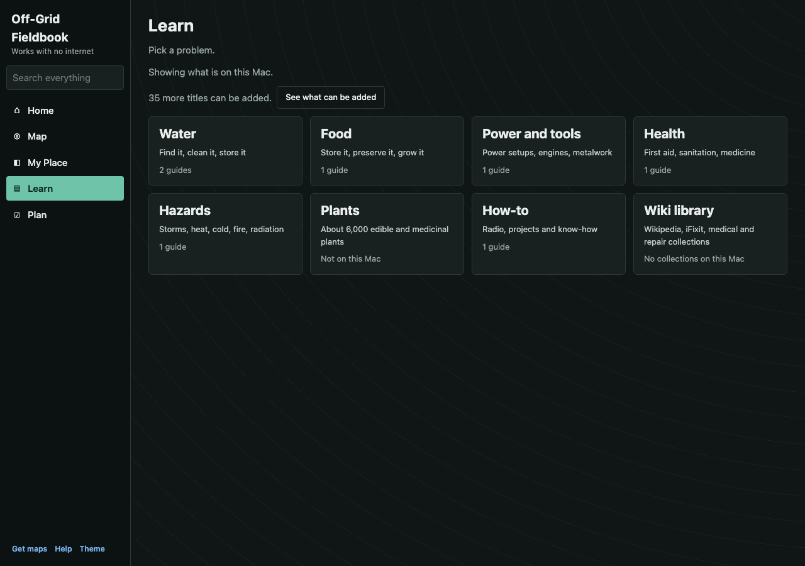

Inside a problem, the easy stuff comes first:

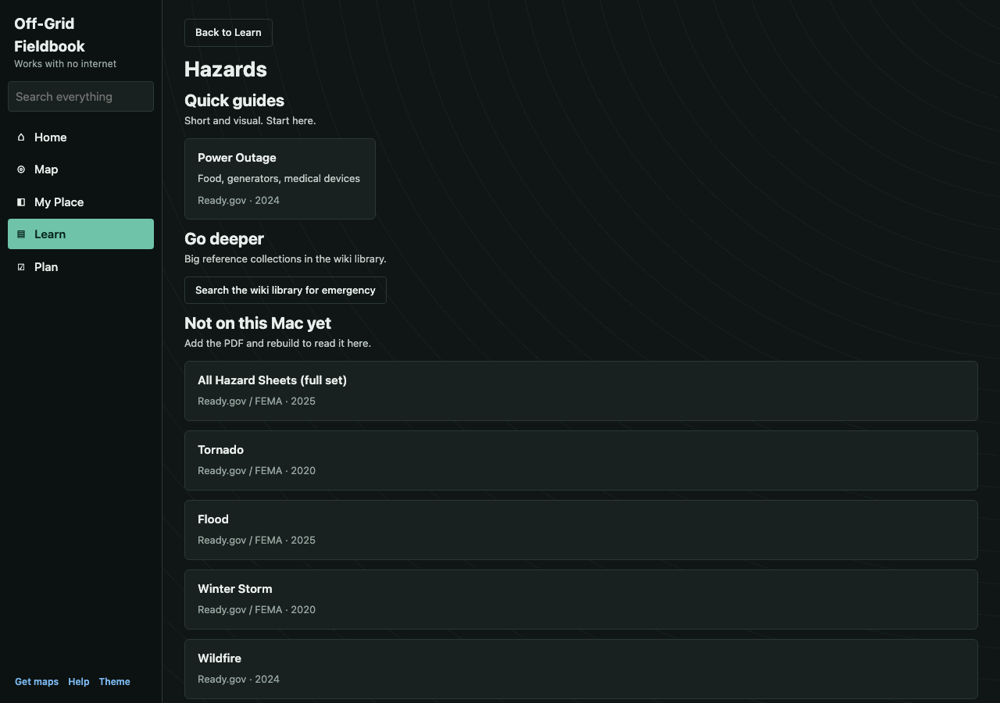

The short guides are visual: numbers, charts and flowcharts you can follow.

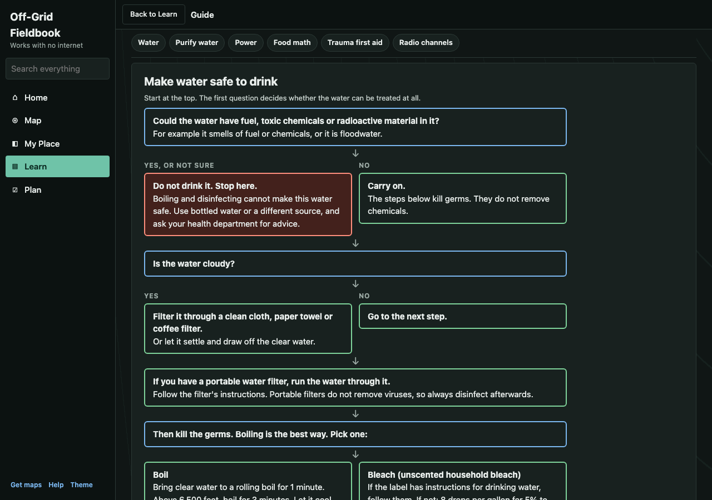

**Plan.** Your own plan pages and checklists, written in Markdown. Tick boxes are remembered.

**Offline check.** One screen that answers "will this work with no internet?" It opens a real map tile, a guide, the help layers and your records, finds the nearest hospital, water and shelter to your Home pin, and says plainly what is ready and what is missing.

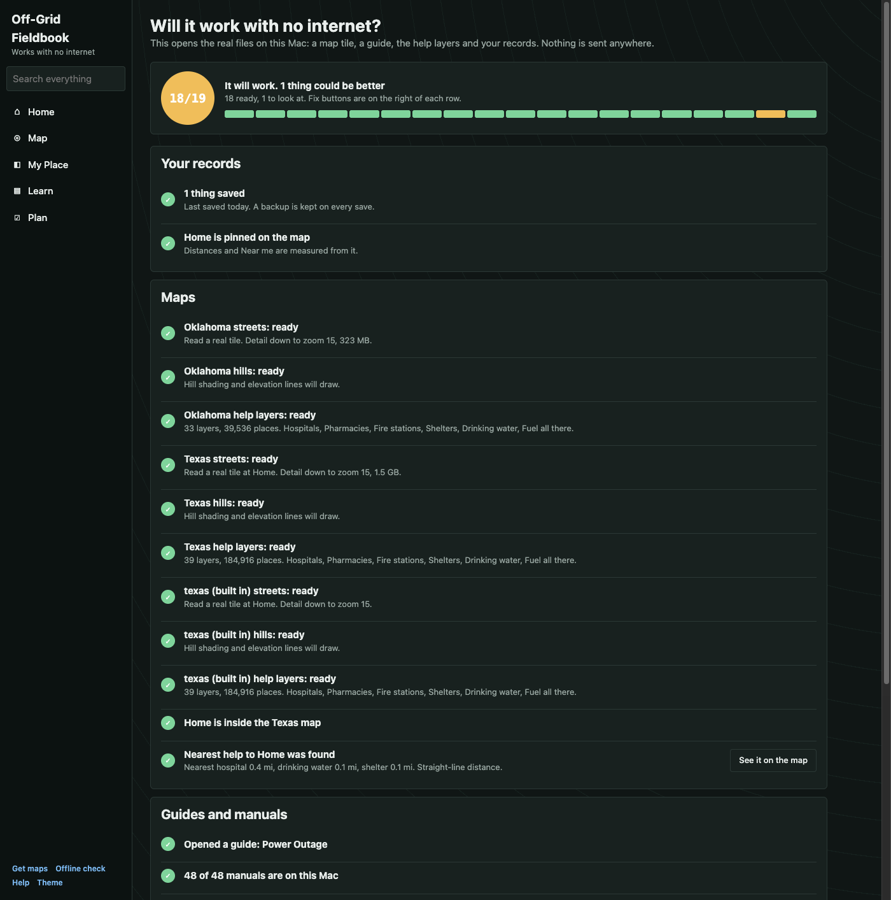

**Search.** One box that looks through your records, every page of every manual, the plant list and your plan at the same time. A hit inside a manual opens the book on that page.

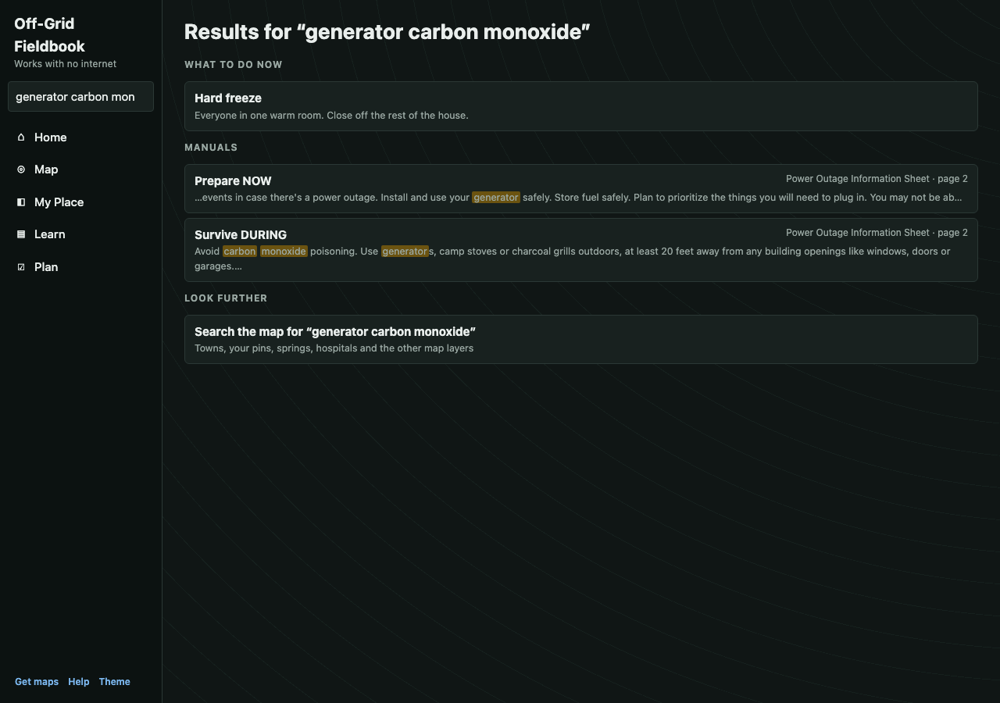

## Get it running

There's no ready-made download yet, so you build it. It takes a few minutes.

You need a Mac on macOS 13 or newer and Apple's command line tools. If you don't have them, run this and follow the prompt:

```
xcode-select --install
```

Then:

```
git clone https://github.com/builtby-hari/Off-Grid-Fieldbook.git
cd Off-Grid-Fieldbook
./app/build-app.sh share
```

The app lands in `Apps/`. Drag it to Applications and open it.

The first time, macOS will say it can't check the developer. That's because the app isn't notarized by Apple. Open **System Settings > Privacy & Security**, scroll down, and click **Open Anyway**. The first launch can also take a minute while macOS scans the app.

A fresh build has no map yet and only the manuals that ship in this repo. The next two sections fix that.

## Get your state's map

Press **Get maps** at the bottom left of the app. Pick your state, pick how much detail you want, check the size, and press Download. When it finishes, press Open the map.

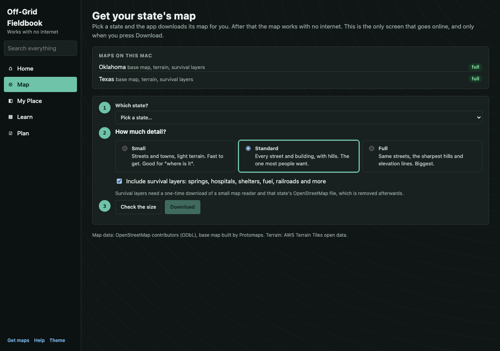

The download uses the Python that comes with Apple's command line tools. If your Mac doesn't have them yet, the screen tells you and has a button that opens Apple's installer.

You only need the internet for this one step. A stopped download picks up where it left off.

### Or from Terminal

Maps come as packs, one per state. The same tool the app uses also runs on its own. It shows you the size before it downloads anything.

```
tools/packs/offgrid-pack regions            # every region you can get
tools/packs/offgrid-pack plan texas         # exact sizes, nothing downloaded
tools/packs/offgrid-pack setup              # one time: installs the OpenStreetMap reader
tools/packs/offgrid-pack get texas          # download it
tools/packs/offgrid-pack list               # what you have and where
```

Three sizes:

| Level | What you get |
|---|---|
| `lite` | Streets to zoom 12, terrain to zoom 10. Good for "where is it" |
| `standard` | Every street and building, terrain to zoom 11. The default |
| `full` | Every street and building, terrain to zoom 12. Best hills and elevation lines |

Add `--level lite` to pick one. Add `--to /Volumes/YourDrive/Packs` to put a pack on an external drive. For scale, all of Texas at `full` is about 3.9 GB and Oklahoma is about 1 GB.

What a pack is made of:

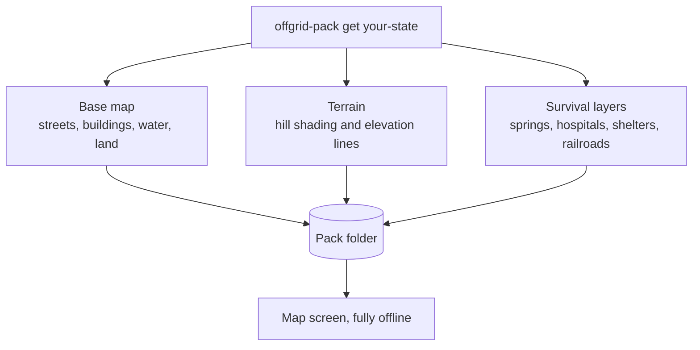

Either way, the map is fully offline once it has downloaded. Open Map and pick your state under "Map file".

## Add the library

The big reference collections (Wikipedia, iFixit, medical and repair guides) are Kiwix `.zim` files. Get the ones you want from [library.kiwix.org](https://library.kiwix.org) and put them in `downloads/zim/` before you build. The reader that opens them, `kiwix-serve`, goes in `vendor-dl/kiwix-tools/`. See `tools/build-kits.sh` for the exact folders it looks in.

PDF manuals work the same way: drop them under `downloads/extra/library/` and list them in `content/library/pdf-catalog.json`. Then run this so search can read every page:

```
swiftc -O tools/library/pdf_text.swift -o tools/library/pdf_text
python3 tools/library/build_index.py
```

Only add documents you're allowed to have. The catalog marks each one as public domain, share with credit, or personal use only, and the `share` build leaves out anything that isn't shareable.

## Your data stays yours

Everything you save lives in `~/Library/Application Support/com.builtbyhari.offgrid/` on your Mac: your records, photos, and the last 40 versions of your records file as backups. It sits outside the app, so rebuilding or replacing the app never touches it.

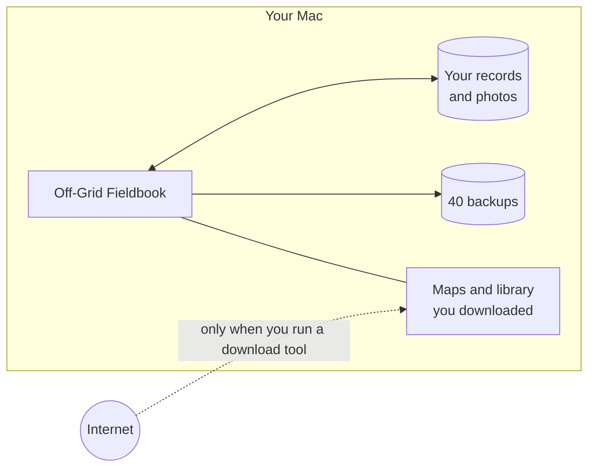

The app runs a small server that only your own Mac can reach (`127.0.0.1`). It makes no network requests while you use it. The only things that go online are the download tools above, and only when you run them.

## How it's built

 It is split by job: `Server.swift`, `Records.swift`, `Packs.swift`, `Setup.swift`, `Files.swift`, `Kiwix.swift`, `Window.swift` and a short `main.swift`.
- **The screens** are plain HTML, CSS and JavaScript in `app/web/`. No framework and no build step. `ui.css` is the one design system, `og.js` is the one place records are read and saved, and `CONTRACT.md` explains how the screens talk to each other.
- **The map** is in `app/web/map/`, built on MapLibre GL JS and PMTiles.
- **The setup service** in the shell runs the map pack tool for the Get maps screen, one download at a time, and only when you press the button.
- **The tools** in `tools/` download map packs, build the map layers from OpenStreetMap data, and build the search index.

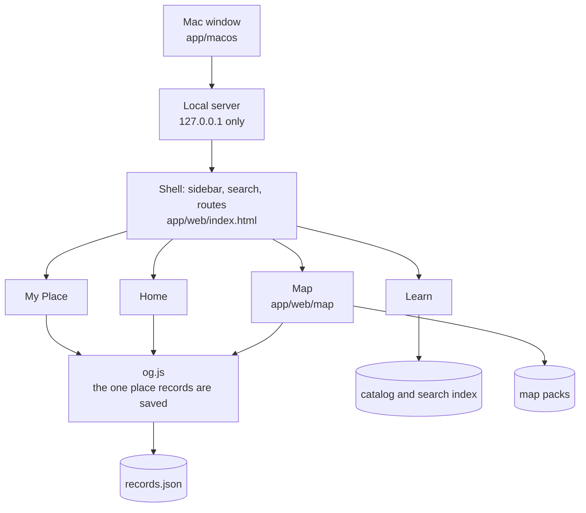

There are two builds:

| Command | What it makes |
|---|---|
| `./app/build-app.sh` | Your own copy, with your plan pages and everything you've added |
| `./app/build-app.sh share` | A copy that's safe to hand to someone: no plan, no map files, and only documents on the approved list. The build stops if it finds anything else |

## Credits and licenses

The code in this repo is MIT licensed. See [LICENSE](LICENSE).

The maps, fonts, libraries and documents come from other people and keep their own terms. The full list is in [THIRD_PARTY.md](THIRD_PARTY.md). The short version: map data is from OpenStreetMap contributors (ODbL), the map engine is MapLibre GL JS, terrain is from the AWS Terrain Tiles open data set, and the hazard steps and sheets are US federal public domain material from Ready.gov, FEMA, the CDC and the USDA.

## Want to help?

See [CONTRIBUTING.md](CONTRIBUTING.md). Bug reports and small fixes are welcome. [ROADMAP.md](ROADMAP.md) lists what is done and what is next.

## One honest warning

This is a reference, not a doctor and not an emergency service. Official instructions always win. In a real emergency, get help if any help can be reached.

Built by Hari.
